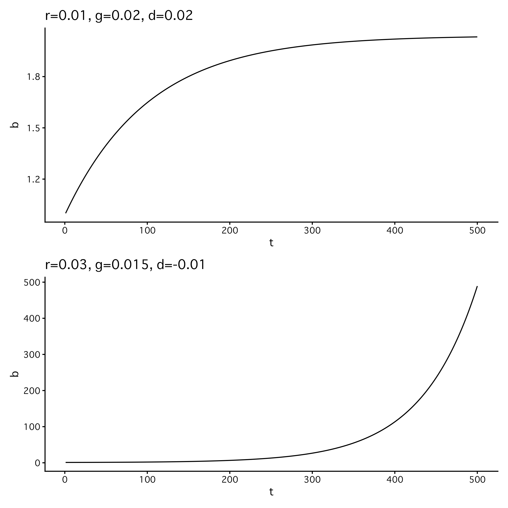
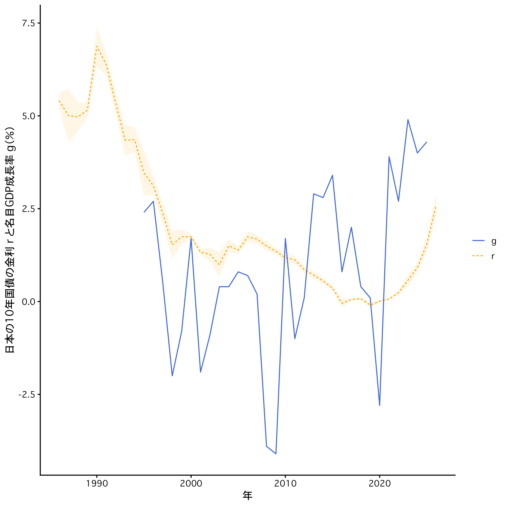

## このノートについて

国債残高と GDP の比が収束する条件として，経済学の分野で知られるドーマー条件というものを紹介します．

ドーマー条件の解説は主に [飯田泰之『財政・金融政策の転換点 日本経済の再生プラン』（中公新書）](https://www.chuko.co.jp/shinsho/2023/12/102784.html) に依拠しています． 

ただし私は経済学に関しては素人であり，この記事も経済の解説というよりは高校数学にはこういう（文系分野の）応用もあるんだぞ！　というニュアンスのほうが強めです．

ドーマー条件は諸々の単純化を経たものですから，ドーマー条件だけを財政維持の指標とすることはできないと思われます．しかし，指針のひとつとして関心の対象ではあります．

## 準備：等比数列

公比 $r$ の等比数列の漸化式 $b_{i+1} =r b_i$ ($i=1,\ldots,n$) を考えます．初項を $b_1$ とします．

次のように順次具体的に計算してみると，

- $b_2 = r b_1$
- $b_3 = r b_2 = r^2 b_1$
- $b_4 = r b_3 = r^3 b_1$
- ...

一般項は次の形で書けることがわかります．

$$
b_n = r^{n-1} b_1.
$$

また，次の等比数列の和 

$$
S_n = \sum_{i=1}^n b_i = \sum_{i=1}^nr^{i-1} b_1.
$$

も考えてみます．次のように $S_n$ と $r S_n$ の差を考えると，

$$
\begin{aligned}
S_n &= b_1+rb_1+r^2b_1+r^3b_1+\cdots+r^{n-1}b_1 \\
rS_n &= \phantom{b_1+{}}rb_1+r^2b_1+r^3b_1+\cdots+r^{n-1}b_1+r^{n}b_1 \\
S_n-rS_n &= b_1-b_1r^n
\end{aligned}
$$

より，$r \neq 1$ ならば次のように求まります．

$$
S_n = \frac{(1-r^n)b_1}{1-r}.
$$

さて，少し応用問題として，次に $b_{i+1} =a b_i+d$ ($i=1,\ldots,n$) という形の漸化式を考え，一般項を求めてみます．初項を $b_1$ とします．

次のように順次具体的に計算してみると，

- $b_2 = a b_1 + d$
- $b_3 = a b_2 +d = a^2 b_1 + ad + d$
- $b_4 = a b_3 +d = a^3 b_1 + a^2d + ad +d$
- ...

一般項は次の形で書けることがわかります．

$$
b_n=a^{n-1} b_1+\sum_{i=1}^{n}a^{i-1}d.
$$

右辺の第2項は初項 $d$, 公比 $a$ の等比数列の和なので，$a \neq 1$ なら次のように求まります．

$$
\sum_{i=1}^{n}a^{t-i}d =\frac{(1-a^n)d}{1-a}.
$$

よって， $b_{i+1} =a b_i+d$ の形の漸化式の一般項は，

$$
b_n=a^{n-1} b_1+\frac{(1-a^n)d}{1-a}
$$

となります．

$n\to\infty$ の極限を考えます．$a<1$ のときは，

$$
\lim_{n\to\infty}a^n=0
$$

なので，一般項の極限は，

$$
\lim_{n\to\infty}b_n =\frac{d}{1-a}.
$$

## モチベーション

財政の持続可能性には色々な論点があるでしょうが，ここではひとまず次のように考えます．

国の借金は国債です．国の経済規模に対して国債が膨らみ続けるような状況になれば，利息分の支払いが歳入を超えることになり，税制やその他の政策は大幅な変更を余儀なくされるだろうとは言えそうです．

そこで国債残高と GDP の比を考え，これが発散するような状況がどんなときか見ていきます．

## ドーマー条件

$t$ 期の GDP を $Y_t$ と置きます．GDP の成長率を $g$ とすると，

$$
Y_{t+1} = (1+g)Y_t. 
$$

$t$ 期の国債残高 $B_{t}$ と置き，$t+1$ 期の国債残高を考えます．財政赤字を $D_{t+1}$ とすると，$t+1$ 期の国債残高は金利で膨らんだ分と今期の財政赤字の和で表せます.

$$
B_{t+1} = (1+r)B_{t} + D_{t+1}. 
$$

国債残高と GDP の比を考えます．

$$
\begin{aligned}
\frac{B_{t+1}}{Y_{t+1}} &= \frac{(1+r)B_{t} + D_{t+1}}{(1+g)Y_t} \\
&= \frac{(1+r)B_{t} }{(1+g)Y_t} + \frac{D_{t+1}}{Y_{t+1}}.
\end{aligned}
$$

整理のため，$A=(1+r)/(1+g)$, $b_t=B_{t}/Y_t$, $d_t=D{t+1}/Y_{t+1}$ と置くと，次の漸化式が得られます．

$$
b_{t+1} = A b_t + d_{t+1}
$$

ここで，財政赤字GDP比が一定 $d_t=d$ であるとします．

$$
b_{t+1} = A b_t + d
$$

このように変形すると，「準備：等比数列」の節で考えた $b_{i+1} =a b_i+d$ という形の漸化式とまったく同じであることがわかります．

収束するのは $A<1$ のときでした．元の記号に戻すと，

$$
A=\frac{1+r}{1+g}<1
$$

より

$$
r<g 
$$

のとき国債残高と GDP の比は収束します．つまり，名目の GDP 成長率が国債金利を上回れば，どこかには収束するということです．この条件 $r<g$ はドーマー条件と呼ばれます（ちなみに，[トマ・ピケティ『21世紀の資本』](https://www.msz.co.jp/book/detail/07876/) に出てくる $r<g$ の $r$ は資産の収益率で国債金利とは別のものです）．

収束先は，

$$
1-A = \frac{g-r}{1+g}
$$

より，

$$
\lim_{t\to\infty}b_t = d \frac{1+g}{g-r} 
$$

となります．

$g$, $r$, $d$ などに具体的な数を入れてグラフを見てみましょう．$r=0.01$, $g=0.02$, $d=0.02$, $b_1=1$ としたシナリオと，
$r=0.03$, $g=0.015$, $d=-0.01$, $b_1=1$ としたシナリオの2つを描いてみました．$d$ が負になるのはマイナスの財政赤字ですから，つまり財政黒字を意味します．

*架空の債務GDP比率の推移例．テキストとした飯田泰之『財政・金融政策の転換点 日本経済の再生プラン』（中公新書）図3-3の再現に相当．*

財政赤字が出ていても経済成長率が国債金利を上回れば収束し，財政黒字が出ていても国債金利が経済成長率を上回れば発散するというのがおもしろいところです．

参考資料として，最後に日本の実際の名目 GDP 成長率と10年国債の金利の推移を載せておきます．

データはそれぞれ以下によります．

- 名目 GDP 成長率：[内閣府・国民経済計算（GDP統計）](https://www.esri.cao.go.jp/jp/sna/menu.html)
- 10年国債の金利：[Japan Yield Curve](https://japanyieldcurve.com/data/)

*国債金利と名目GDP成長率の推移．半透明の帯はプラスマイナス標準偏差の範囲．*

直近の経済成長率は国債金利を上回っていることがわかります．

作図に用いた R のコードはこちら：

https://github.com/abikoushi/Zenn_content/blob/main/R/domars_condition.R