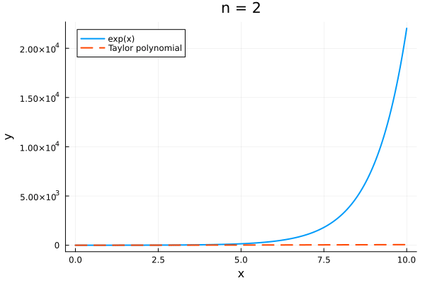
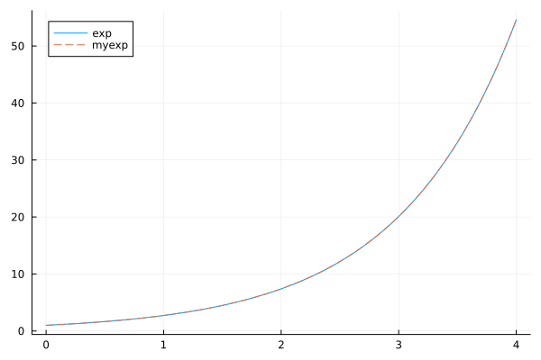
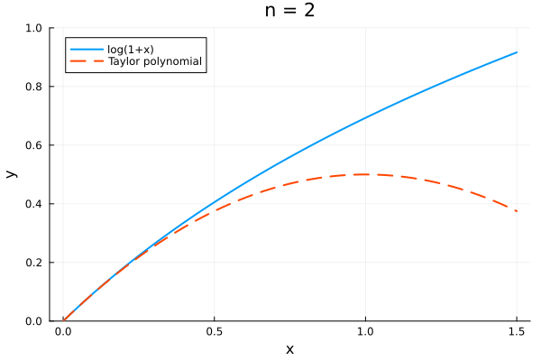

## このノートについて

多くのプログラミング言語（R, Python, Julia, C++, ...）では $\exp(x)-1$ を計算する `expm1` や，$\log(1+x)$ を計算する `log1p` が， `exp` や `log` とはわざわざ別に定義されています．

このような関数があることは他人から言われないとなかなか気づかないのではないかと思うのでこの記事で軽く紹介したいと思いました．私も他人のコードを見てはじめて知った記憶があります．

これらは「指数関数の部分を計算してから 1 引く」「1 足してから対数を計算する」ではなく $\exp(x)-1$ や $log(1+x)$ を直接計算するので精度が高いのですが，「直接」ってどういうこと？　と思うと思うので簡単に説明します．

本文中のプログラム例は Julia です．Julia は比較的ソースを確認しやすかったので Julia を用いることにしました．

## expm1

指数関数を四則演算や整数のべき乗などを使って自分で実装してみよ，と言われたとします．素朴な方法として，まずテイラー展開を使って多項式で近似する方法を考えます．

$$
\exp(x) = 1 + x + \frac{1}{2}x^2+ \frac{1}{3!}x^3 + \frac{1}{4!}x^4 + \cdots.
$$

有限の $n$ 次までの多項式をプロットし，$n$ を増やしながら GIF アニメにしてみました．



$x$ が0に近いときは現実的な $n$ で精度よく近似できそうです．

$x$ が 0 に近くないときはどうするんだという問題がありますが，$\log2=0.6931471805599453$ を記録しておいて，次のように $x = k \log 2 + r$ と分解すれば小さい $r$ についての指数を計算するだけで済みます．

$$
\begin{aligned}
\exp(x) &= \exp(k \log 2 + r)\\
&= 2^k \exp(r).
\end{aligned}
$$

ここで $k$ は整数で，$r$ は $k \log 2$ の残差です．

この考察を Julia で次の `myexp` のように実装してしてみます．

```julia
using Plots

# n次 Taylor 多項式
function poly_n_exp(x, n)
    return sum(x^k / factorial(k) for k in 0:n)
end

function myexp(x)
    log2 = 0.6931471805599453
    k, r = divrem(x, log2) #商の整数部分 k とあまり r
    return 2^k * poly_n_exp(r, 10)
end

plot(exp, 0, 4, label="exp")
plot!(myexp, label="myexp", linestyle=:dash)
```



プロットをみると `exp` と `myexp` で近い値になっていることがわかります．

Julia のソース（ https://github.com/JuliaLang/julia/blob/master/base/special/exp.jl ）を見ると `exp` の実装は `myexp` よりもっと色々な工夫が凝らされているようですが，とりあえずここまでで「`expm1` は $\exp(x)-1$ を直接計算する」の意味はわかります．多項式による近似の第一項は 1 なので，これを除いて計算すれば $\exp(x)-1$ が得られます．

$$
\exp(x)-1 = x + \frac{1}{2}x^2+ \frac{1}{3!}x^3 + \frac{1}{4!}x^4 + \cdots.
$$

指数関数が精度よく計算できたとしても，ほぼ 1 から 1 を引くと桁落ちが発生して 0 になってしまうことがあるので，次のような場合を比較すると `expm1` の精度が高いことがわかります．

```julia
julia> exp(1e-16)-1.0
0.0

julia> expm1(1e-16)
1.0e-16
```

## log1p

次に，対数関数を多項式で近似することを考えますが，$\log(x)$ は $x=0$ で発散してしまうので， $\log(1+x)$ を 0 の周りでテイラー展開します．

$$
\log(1+x) = x - \frac{1}{2}x^2 + \frac{1}{3}x^3 - \frac{1}{4}x^4 + \cdots.
$$

有限の $n$ 次までの多項式をプロットし，$n$ を増やしながら GIF アニメにしてみます．



$0<x<1$ の範囲で収束し，これも $x$ が 0 に近いときは精度がよさそうです．

ここでもやはり $x$ が 0 に近くないときはどうするんだという問題がありますが，次のように $x = 2^k(1+r)$ と分解すれば小さい $r$ について $\log(1+r)$ を計算することで対処できます．

$$
\begin{aligned}
\log(x) &= \log(2^k(1+r))\\
&=k\log(2)+\log(1+r).
\end{aligned}
$$

ここで $k$ は整数です．

浮動小数点型では値を次のように符号部，仮数部，指数部にわけて保存しているので，仮数部と指数部を取り出せば $k$ と $r$ が得られます．

$$
\text{値} = \text{符号部} \times \text{仮数部} \times 2^\text{指数部}
$$

ここまでの考察を Julia で次の `mylog` のように実装してしてみます．

```julia
# n次 Taylor 多項式
function poly_n_log1p(x, n)
    return sum((-1)^(k+1) * x^k / k for k in 1:n)
end

function mylog(x)
    x > 0 || throw(DomainError(x))
    log2 = 0.6931471805599453
    m, e = frexp(x)
    r = 2m - 1.0
    k = e - 1
    return k*log2 + poly_n_log1p(r, 20)
end

plot(log, 0, 4, label="log")
plot!(mylog, label="mylog", linestyle=:dash)
```


プロットをみると `log` と `mylog` で近い値になっていることがわかります．

これも Julia のソース（ https://github.com/JuliaLang/julia/blob/master/base/special/log.jl ）を見ると，実際の `log` の実装はもっと複雑ですが，このように見ていくと $\log(1+x)$ をわざわざ別の関数として実装することが自然に思えてきます．

$x$ の絶対値が小さいときは多項式近似の `poly_n_log1p` を「直接」使えるからです．

次のような場合を比較すると `log1p` の方が精度がいいことがわかります．


```julia
julia> log(1+1e-16)
0.0

julia> log1p(1e-16)
1.0e-16
```

GIF アニメの作成も含めた Julia のコードはこちら：

https://github.com/abikoushi/Zenn_content/blob/main/jl/expm1_and_log1p.R
