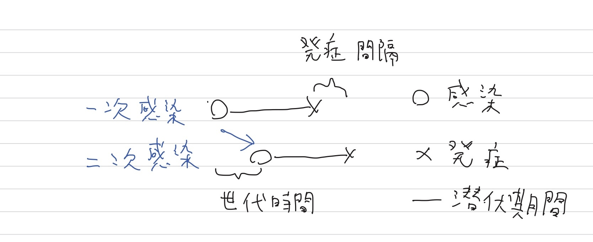
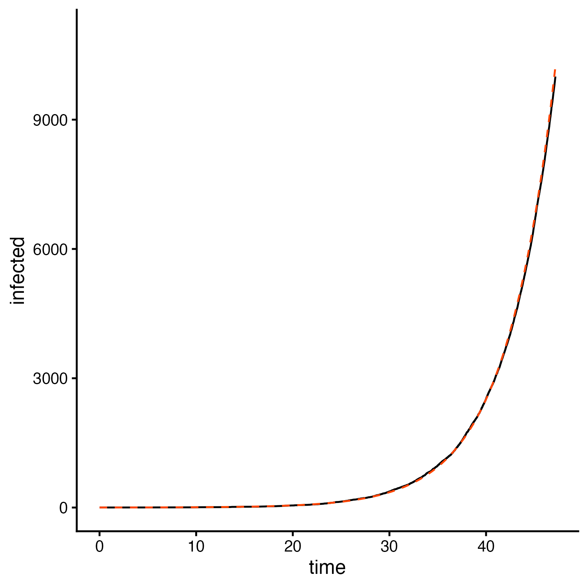
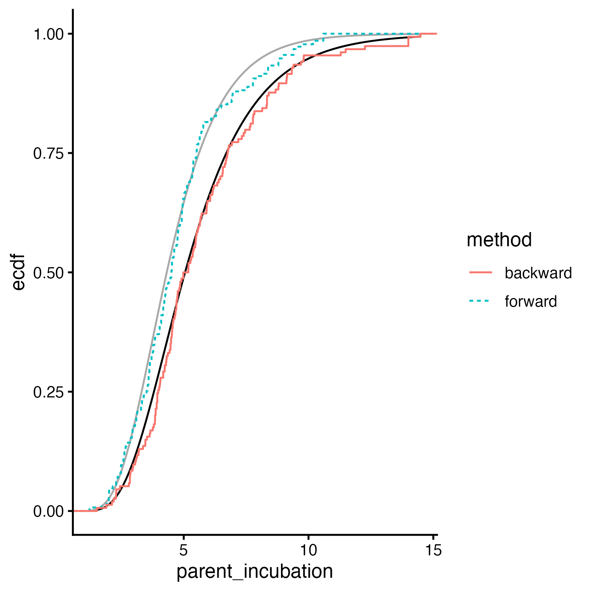
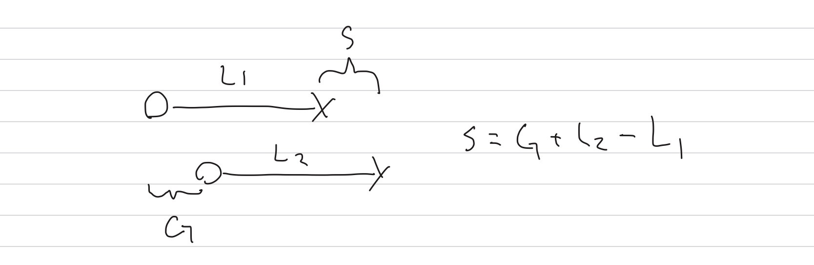

## はじめに

タイトルにある Park et al.(2021) は

S.W. Park, K. Sun, D. Champredon, M. Li, B.M. Bolker, D.J.D. Earn, J.S. Weitz, B.T. Grenfell, & J. Dushoff, Forward-looking serial intervals correctly link epidemic growth to reproduction numbers, Proc. Natl. Acad. Sci. U.S.A. 118 (2) e2011548118, https://doi.org/10.1073/pnas.2011548118 (2021)

です．主にこの結果を紹介します．

さて，基本再生産数は感染者1人あたりの生み出す二次感染者の数として定義され，感染症の広まりやすさを示す基本的な指標のひとつです．

基本再生産数は感染者が生み出す二次感染者の数を生涯にわたって積算した値であるため，現実の時間と対応付けるには，感染から二次感染者の感染までの間隔である **世代時間**（generation time）の情報が必要になります．

世代時間の密度関数を $g(t)$, 感染の指数関数的増加率を $r$ とすると，後述（[世代時間のオイラー・ロトカ積分](#世代時間のオイラー・ロトカ積分) の節）の理由により基本再生産数に関する次の等式が成り立ちます．

$$
R_0 = \frac{1}{\int_0^\infty e^{-ru}g(u)\,du}.
$$

この等式はオイラー・ロトカ方程式と呼ばれ，指数関数的増加率と世代時間が分かれば基本再生産数を推定できることを意味しています．

ところが，潜伏期間のある感染症では感染した時点を特定するのが難しいという問題があります．そこで世代時間の代替として発症から二次感染者の発症までの間隔である **感染間隔**（serial interval）を用いることを考えます．

Park et al.(2021) では，一次感染者の発症時点を固定してサンプリングを行い，二次感染者の発症時点までの間隔を調べた **前方視的感染間隔**（forward-looking serial interval）を用いた場合，世代時間を用いたものと同じ基本再生産数が得られることを指摘しています．

すなわち，前方視的感染間隔の密度関数を $f_0(t)$ とすると，次の等式が成り立ちます．

$$
R_0 = \frac{1}{\int_0^\infty e^{-ru}f_0(u)\,du}.
$$

この関係を理解することがこの記事の目的です．

## シミュレーションしてみる

まず，世代時間と感染間隔の違いを，図で整理しておきます．



さて，二次感染者の発症日を固定してサンプリングを行い，一次感染者の発症時点までの間隔を調べたものが後方視的感染間隔です．反対に，一次感染者の発症日を固定してサンプリングを行い，二次感染者の発症時点までの間隔を調べたものが前方視的感染間隔です．

しかし，この説明だけだとわかりにくいと思うので，シミュレーションのコードを見てみることにします．

Park et al. (2021) では補足資料として R のコードも公開しています．そのうちの一つ，sir.R のスクリプト ( https://github.com/parksw3/serial/blob/master/sir.R )で定義されている `sir.full` 関数をシミュレーションに用いることにします．

```r
sample2 <- function(x, size) {
  if(length(x)==1) {
    rep(x, size)
  } else{
    sample(x, size, replace=TRUE)
  }
}


sir.full <- function(size,
                     R0=2.5,
                     meanlog=1.62,
                     sdlog=0.42,
                     meanlog2=1.54,
                     sdlog2=0.37,
                     I0,
                     seed = NULL,
                     imax,
                     keep.intrinsic=FALSE){
  
  if (!is.null(seed)) set.seed(seed)
  
  V <- 1:size
  
  if (missing(I0)) {
    stop("specify the initial conditions")
  }
  
  initial_infected <- 1:I0
  
  if (missing(imax)) imax <- size
  
  # queue_v : 次の感染者のID
  # queue_t : 次の感染者の感染時刻
  # queue_infector : 次の感染の感染源のID
  queue_v <- queue_t <- queue_infector <- rep(NA, I0)
  
  queue_v[1:I0] <- initial_infected 
  queue_t[1:I0] <- 0
  
  t_infected <- t_symptomatic <- rep(NA, size)
  t_infected[initial_infected] <- 0
  
  t_gillespie <- NULL
  c_infected <- 0
  
  if (keep.intrinsic) {
    intrinsic_generation <- vector('list', length(V))
  } else {
    intrinsic_generation <- NULL
  }
  
  done <- rep(FALSE, size)
  infected_by <- rep(NA, size)
  
  stop <- FALSE
  
  while (!stop) {
    j.index <- which.min(queue_t) #キューの中から感染時刻が最も早い個体を選択
    j <- queue_v[j.index]
    
    infected_by[j] <- queue_infector[j.index]
    t_infected[j] <- queue_t[j.index]
    
    t <- queue_t[j.index]; t_gillespie <- c(t_gillespie, t)
    
    incubation <- rlnorm(1, meanlog, sdlog)
    t_symptomatic[j] <- t+incubation #発症時刻
    
    c_infected <- c_infected + 1 #累計感染者数
    
    ncontact <- rpois(1, R0) #平均R0人の感染者が発生
    
    n <- V[V != j]
    
    if (ncontact > 0) {
      queue_v <- c(queue_v, sample2(n, ncontact)) #感染者j以外の個体から、二次感染者を抽出
      queue_infector <- c(queue_infector, rep(j, ncontact))
    }
    
    generation <- rlnorm(ncontact, meanlog2, sdlog2) #世代時間
    
    if (keep.intrinsic) intrinsic_generation[[j]] <- generation
    
    if (ncontact > 0) {
      queue_t <- c(queue_t, t + generation)
    }
    
    done[j] <- TRUE #感染済みのフラグ
    
    filter2 <- !done[queue_v] #未感染の個体をキューに残す
    queue_v <- queue_v[filter2]
    queue_infector <- queue_infector[filter2]
    queue_t <- queue_t[filter2]
    
    #終了条件
    stop <- (c_infected == length(V) || #集団全体が感染
               length(queue_v) == 0L || #キュー内に未感染の個体が存在しない
               c_infected == imax) #感染者数が imax に到達
  }
  
  return(
    list(
      data=data.frame(
        time=t_gillespie[(I0):c_infected], #感染イベントの発生時刻
        infected=(I0):c_infected #累計感染者数
      ),
      intrinsic_generation=intrinsic_generation, #世代時間
      t_infected=t_infected, #感染時刻
      t_symptomatic=t_symptomatic, #発症時刻
      infected_by=infected_by #感染源のID
    )
  )
}
```

`meanlog`, `sdlog` が中途半端な数になっていますが，これは文献に基づき COVID19 の潜伏期間に近い値にしているそうです．

シミュレーションを実行し，一次感染と二次感染のペアを作り，世代時間，感染間隔，潜伏期間を求めます．

```r
library(dplyr)
size <- 1000000
R0 <- 2.5

meanlog <- 1.62
sdlog <- 0.42

meanlog2 <- 1.54
sdlog2 <- 0.37

system.time({
  sim <- sir.full(
    size = size,
    R0 = R0,
    meanlog = meanlog,
    sdlog = sdlog,
    meanlog2 = meanlog2,
    sdlog2 = sdlog2,
    I0 = 1,
    imax = 10000,
    seed = 101,
    keep.intrinsic = FALSE
  )
})
#   user  system elapsed 
# 37.706   0.176  37.986 

dat_pairs <- data.frame(t_symptomatic = sim$t_symptomatic,
                        t_infected = sim$t_infected,
                        infected_by = sim$infected_by) |> 
  dplyr::filter(!is.na(infected_by) & !is.na(t_infected)) |>  #感染した個体だけをフィルタ
  mutate(parent_symptomatic = sim$t_symptomatic[infected_by],
         parent_infected = sim$t_infected[infected_by]) |> 
  mutate(serial = t_symptomatic - parent_symptomatic, 
         incubation = t_symptomatic - t_infected,
         parent_incubation = parent_symptomatic - parent_infected,
         generation = t_infected - parent_infected)
```

次のようなデータセットが得られます．

```r
> print(head(dat_pairs))
  t_symptomatic t_infected infected_by parent_symptomatic parent_infected   serial incubation parent_incubation generation
1      42.60121   34.57954      606955           37.16476        29.48174 5.436458   8.021675          7.683012   5.097795
2      51.31894   47.07701      996363           45.98238        42.91119 5.336560   4.241932          3.071189   4.165817
3      49.95536   46.53729       78583           40.03771        38.14683 9.917647   3.418067          1.890885   8.390465
4      53.17872   46.37619      427967           47.21610        41.75348 5.962625   6.802537          5.462617   4.622706
5      49.61664   44.74075      562876           41.73476        39.48474 7.881884   4.875896          2.250014   5.256002
6      42.17664   38.67297      137191           38.16559        33.73246 4.011058   3.503670          4.433126   4.940514
```

現実にはすべての感染の感染源と感染時刻が特定されることは考えにく，これはいわば理想化された状態のテーブルです．ここから，$[39,40]$ の時点で発症者を抽出して，感染源がだれだったか調べたとします．

```r
dat_pairs_b <- dplyr::filter(dat_pairs, 39 <= t_symptomatic & t_symptomatic <= 40)
```

`dat_pairs_b` が後方視的なデータセットです．

また，$[39,40]$ の時点で発症者を抽出して，だれに感染させたかを調べたとします．

```r
dat_pairs_f <- dplyr::filter(dat_pairs, 39 <= parent_symptomatic & parent_symptomatic <= 40)
```

`dat_pairs_f` が前方視的なデータセットです．

最初のポイントは指数関数的流行拡大によって，感染源の潜伏期間の分布が $e^{-rx}$ で重み付けされることです．

感染者数をプロットしてみると time = 40 くらいの時点でも感染はほぼ指数増加です．



SIRモデルなどの区画モデルでも感染流行初期は指数増加になります．これについてより詳しくは以下にリストした記事のどれかを参照してください．

- [基本再生産数と内的増殖率](https://zenn.dev/abe2/articles/r0_and_growthrate)
- [Diekmann et al. (2010) より，疫学における区画モデルと次世代行列の関係](https://zenn.dev/abe2/articles/compartment_ngm)
- [人口の異質性を加味した SIR モデルに基づく次世代行列の構築](https://zenn.dev/abe2/articles/sir_hetero_ngm)

指数関数的増加率 $r$ については，オイラー・ロトカ方程式を $r$ について数値的に解くことで求めることにします．

```r
get_growth_rate <- function(R0, meanlog2, sdlog2) {
  
  f <- function(r) {
    integrate(
      function(g){exp(-r * g) * dlnorm(g, meanlog = meanlog2, sdlog = sdlog2)},
      lower = 0,
      upper = Inf
    )$value - 1 / R0
  }
  
  upper <- 1
  while (f(upper) > 0) {
    upper <- upper * 2
  }
  
  uniroot(f, interval = c(0, upper))$root
}

r <- get_growth_rate(
  R0 = R0,
  meanlog2 = meanlog2,
  sdlog2 = sdlog2
)
```

後方視的なデータセットと前方視的なデータセットの両方で感染源の潜伏期間の経験分布をプロットしてみます．



黒い実線がシミュレーションで設定した対数正規分布の分布関数です．グレーの実線は $e^{-rx}$ で重み付けした対数正規分布です．R の関数としては次のように定義しました．

```r
int <- integrate(function(x){dlnorm(x, meanlog, sdlog)*exp(-r*x)},0,Inf) #正規化定数
p_biased <- function(x){
  sapply(x, function(xv)integrate(function(t){dlnorm(t, meanlog, sdlog)*exp(-r*t)/int$value},0,xv)$value) #正規化しなおし
}
```

後方視的感染間隔と前方視的感染間隔の両方で基本再生産数を求めてみます．

```r
> cat("backward:", 1/mean(exp(-r*dat_pairs_b$serial)) , "\n")
backward: 1.580067 
> cat("forward:", 1/mean(exp(-r*dat_pairs_f$serial)) , "\n")
forward: 2.434675 
```

前方視的感染間隔を用いたほうがシミュレーションで設定した 2.5 に近い値になっていることがわかります．

前方視的なデータセットでは，感染源の潜伏期間が重み付けされることにより，潜伏期間に関する因子がうまく相殺されることがその理由です．これについて，次の [証明してみる](#証明してみる) の節でより詳しく述べます．

シミュレーションに用いたコードの全体は以下に置きます：

https://github.com/abikoushi/Zenn_content/blob/main/R/forward_serial.R

## 証明してみる

### 示したいこと

以下にリストした確率変数を考えます．

- $L_1$：一次感染者の潜伏期間
- $G$：一次感染から二次感染までの間隔（世代時間）
- $L_2$：二次感染者の潜伏期間
- $S$：一次感染者の発症から二次感染者の発症までの間隔（発症間隔）

発症間隔 $S$ は次のように分解できます（下の図を参照）．

$$
S=G+L_2-L_1.
$$



感染発生率は

$$
i(t)=i_0e^{rt},\qquad r>0 
$$

に従うとします．
この仮定は感染流行初期を考えていることに相当します．

感染源の潜伏期間と世代時間の結合確率密度関数を $h(x,u)$ とします．個体1と個体2の潜伏期間の周辺分布は同じ確率密度関数 $\ell(x)$ を持つとします．

$$
\ell(x)=\int_0^\infty h(x,u)\,du.
$$

世代時間の周辺分布を $g(u)$ とします．

$$
g(u) =\int_0^\infty h(x,u)\,dx.
$$

このとき，次が成り立ちます．

$$
\frac{1}{R_0} = \int_0^\infty e^{-ru}g(u)\,du = \int_{-\infty}^{\infty} e^{-rs}f_0(s)\,ds. \tag{0}
$$

### 世代時間のオイラー・ロトカ積分

感染発生率 $i(t)$ が世代時間分布 $g(u)$ に従う更新方程式は，

$$
i(t)=R_0\int_0^\infty g(u)i(t-u)\,du.
$$

いま，感染発生率が指数関数で表されるとしていたので，$i(t)=i_0e^{rt}$ より，

$$
i_0e^{rt} = R_0\int_0^\infty g(u)i_0e^{r(t-u)}\,du.
$$

両辺を $i_0e^{rt}$ で割ると次を得ます．

$$
1=R_0\int_0^\infty e^{-ru}g(u)\,du. 
$$

これが標準的にオイラー・ロトカ方程式と呼ばれている方程式です．これより，

$$
\frac{1}{R_0} = \int_0^\infty e^{-ru}g(u)\,du. \tag{1}
$$

### 前方視的発症間隔のオイラー・ロトカ積分

指数関数的拡大期において，感染源の感染時刻が流行中の感染発生率に比例して観測されることを考えます．個体1の発症時刻を0としたとき，その感染時刻は $-L_1$ です．したがって，感染源の感染時刻に由来する重みは $e^{-rL_1}$ となります．

このため，前方視的に観測される感染源の潜伏期間の分布は，通常の潜伏期間分布 $\ell(x)$ そのものではなく，

$$
\ell_{\mathrm{fwd}}(x) = \frac{e^{-rx}\ell(x)}{\phi}
$$

となります．ここで，正規化定数 $\phi$ は

$$
\phi=\int_0^\infty e^{-rx}\ell(x)\,dx.
$$

したがって，前方視的発症間隔 $S$ の確率密度関数は，次のように表せます．

$$
\begin{aligned}
f_0(s) ={}&\frac{1}{\phi} \int_0^\infty \int_0^\infty \int_0^\infty e^{-rx}h(x, u)\ell(v)\\\ &\qquad\qquad\times \delta(s-(u+v-x)) \,dv\,du\,dx.
\end{aligned} \tag{2} 
$$

ここで，$\delta(\cdot)$ はディラックのデルタ関数です．$\delta(s-(u+v-x))$ の部分は確率1で $S=G+L_2-L_1$ という関係を表しています．

求めたい積分を $I$ とします．

$$
I= \int_{-\infty}^{\infty} e^{-rs}f_0(s)\,ds. 
$$

式 (2) を用いると，

$$
\begin{aligned} 
I ={}&\frac{1}{\phi} \int_{-\infty}^{\infty} e^{-rs} \int_0^\infty \int_0^\infty \int_0^\infty e^{-rx}\ell(x)g(u)\ell(v)\\
&\qquad\qquad\times \delta(s-u-v+x) \,dv\,du\,dx\,ds.
\end{aligned}
$$

デルタ関数の性質を利用すると，

$$
\int_{-\infty}^{\infty} e^{-rs}\delta(s-(u+v-x))\,ds = e^{-r(u+v-x)}. 
$$

したがって，

$$
\begin{aligned}
 I ={}&\frac{1}{\phi} \int_0^\infty \int_0^\infty \int_0^\infty e^{-rx}\ell(x)g(u)\ell(v)\\\ &\qquad\qquad\times e^{-r(u+v-x)} \,dv\,du\,dx. 
\end{aligned}
$$

指数関数の項を整理すると，

$$
e^{-rx}e^{-r(u+v-x)} = e^{-ru}e^{-rv}.
$$

よって，

$$
\begin{aligned} 
I &=\frac{1}{\phi}  \left(\int_0^\infty\int_0^\infty 
 e^{-ru}h(u,x) \,dx\,du\right) \left(\int_0^\infty e^{-rv}\ell(v)\,dv\right)\\
&= \frac{1}{\phi}  \left(\int_0^\infty 
 e^{-ru}g(u)\,du\right) \left(\int_0^\infty e^{-rv}\ell(v)\,dv\right)\\
\end{aligned} 
$$

正規化定数 $\phi$ の定義から

$$
\phi=\int_0^\infty e^{-rv}\ell(v)\,dv
$$

であることを思い出すと，

$$
\begin{aligned} I &= 
\frac{ \left(\int_0^\infty e^{-ru}g(u)\,du \right)
\left(\int_0^\infty e^{-rv}\ell(v)\,dv \right)}{ \int_0^\infty e^{-rv}\ell(v)\,dv }\\
&= \int_0^\infty e^{-ru}g(u)\,du.
\end{aligned} 
$$

以上より，次が得られます．

$$
\int_{-\infty}^{\infty} e^{-rs}f_0(s)\,ds = \int_0^\infty e^{-ru}g(u)\,du .
$$

(1) とまとめると，

$$
\frac{1}{R_0} = \int_0^\infty e^{-ru}g(u)\,du = \int_{-\infty}^{\infty} e^{-rs}f_0(s)\,ds.
$$

これにより，前方視的発症間隔分布 $f_0(s)$ を用いても，世代時間分布 $g(u)$ を用いた場合と同じ基本再生産数が得られることが示されました．

おしまい．